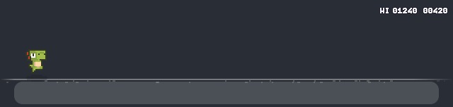
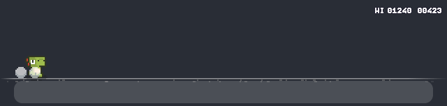
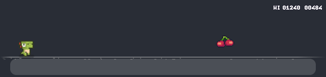
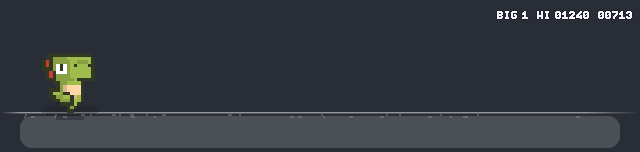
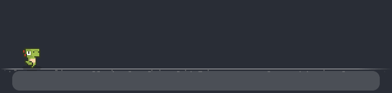

# Dockosaur

A tiny pixel dino that runs on top of your macOS Dock. Play it while you work: jump from any app without switching windows.



## Play

- **Jump:** tap **Right ⌥**, press **⌃⌥Space**, or click the strip. Hold to jump higher.
- **Jump** spikes, crates, saws and low-gliding pterodactyls. **Stay down** under high-flying pterodactyls.
- **Pits:** a PIT AHEAD sign warns you, then a red pebble marks the edge. The ground only caves in
  when you're right on top of it, so jump at the pebble. Pits are about 3/4 of a full jump wide: hold the jump.
- **Fire pits** (from 300): FIRE PIT AHEAD. Flames shoot up when the ground opens, so jump high and on time.
- Jump a crate and the dino does a 360 somersault.
- **Fruit** (+50 each):
  - Cherry and orange: just points.
  - Strawberry: the dino grows huge for 6 s and smashes everything it touches (+10 per smash).
  - Juice box: turbo for 5 s. The dino straps on roller skates and sips the juice while it zooms along
    at super speed, dodging everything by itself. No input needed.
  - The dino blinks as a power wears off, and stays safe for a moment after.
- It speeds up as you go, and your best score is saved.

Clicks pass through to your windows unless the pointer is over the strip, and clicking it never takes focus from the app you're typing in. Right-click the strip for settings: dino colour, size, width, sound, autopilot, launch at login.

## Tour

**360 over crates.** Clear a crate and the dino throws in a somersault.



**Strawberry: go giant.** The dino grows huge for 6 seconds and stomps through spikes, saws, pterodactyls and crates (+10 each).



**Juice box: turbo.** Roller skates on, straw in, and the dino zooms along at super speed, dodging everything by itself while it sips.



**Pits and fire pits.** Watch for the sign, then jump at the little red pebble. The ground only caves in at the last moment, and fire pits come with flames.



The demos are recorded from the game itself: `Dockosaur --record docs/demo.gif` (see `--from`, `--to`, `--fps`).

## Install with a prompt

Paste this into Claude Code:

```text
Install Dockosaur (https://github.com/pratikaman/dockosaur) on this Mac:

1. Clone it to ~/dockosaur. It needs the Xcode Command Line Tools; if swiftc is
   missing, tell me to run `xcode-select --install` and stop.
2. In ~/dockosaur run ./build.sh --install (builds, self-tests, copies to /Applications).
3. Run: open /Applications/Dockosaur.app
4. Tell me to allow Dockosaur in System Settings → Privacy & Security → Input Monitoring,
   so Right ⌥ can jump from any app. ⌃⌥Space and clicking work without it.
```

## Manual install

```sh
git clone https://github.com/pratikaman/dockosaur ~/dockosaur
cd ~/dockosaur && ./build.sh --install && open /Applications/Dockosaur.app
```

Needs macOS 14+.

## Credits

- Dinos: [Dino Characters](https://arks.itch.io/dino-characters) by Arks ([@ArksDigital](https://twitter.com/ArksDigital)),
  licensed [CC BY 4.0](https://creativecommons.org/licenses/by/4.0/). Used unmodified.
- Spikes, crates, saw, fruit and font: [Pixel Adventure](https://pixelfrog-assets.itch.io/pixel-adventure-1) by Pixel Frog, CC0
- Pterodactyls, pit sign, pebble, juice box and roller skates: drawn for Dockosaur (`Tools/ptero.swift` regenerates `Resources/Art/ptero.png`)
